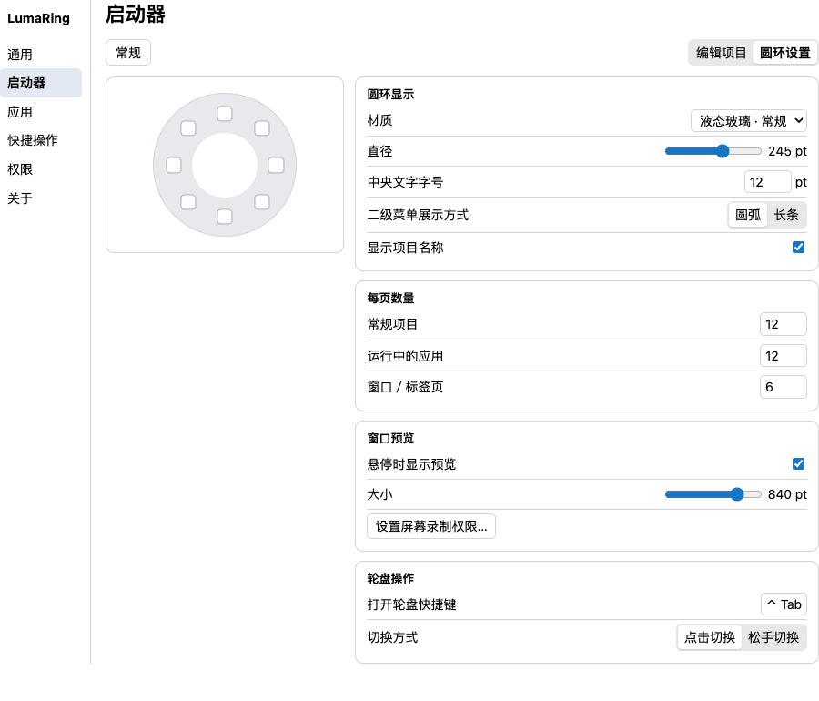
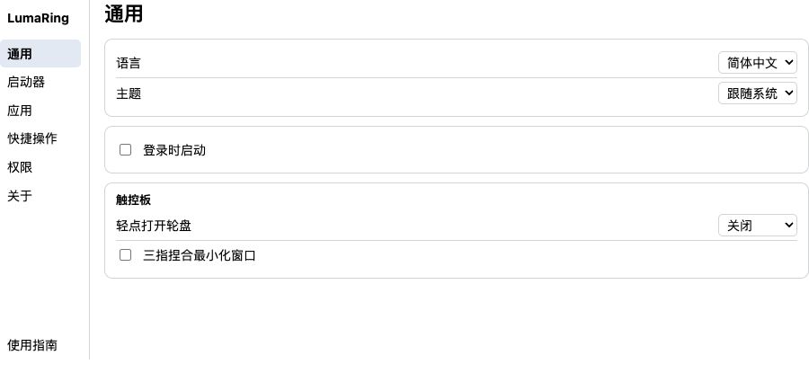

# 待实现需求

这里记录 LumaRing 的需求、设计方案和实现进度。后续需求可以按同样的格式追加。

## 界面文案规则

设计和实现都只保留帮助用户识别控件、完成操作或了解状态的文字。控件和布局已经表达清楚时，省去重复的说明和标签。保留必要的控件名称、无障碍标签和错误提示。

## 启动器统一控制项目名称

**已实现。**

在「启动器 → 圆环设置」中加入「显示项目名称」开关，解决主圆环和二级菜单中有的图标显示名称、有的没有的问题。

- 开关默认开启，设置会保存。主圆环以及圆弧、长条两种二级菜单共用这个设置。
- 开启时，每个项目的图标下方都显示名称，长名称按空间截断。关闭时，图标下方的名称全部隐藏，悬停时仍可在圆心查看当前项目名称。
- 设置页预览随开关即时更新，与实际启动器一致。

Figma 设计稿 · [圆弧]({{URL_a2363b2b}}) · [长条]({{URL_08788704}}) · [隐藏名称]({{URL_737842fc}})

## 调整轮盘快捷键与切换方式的位置

**已实现。**

- 「启动器 → 圆环设置」保留「圆环显示」组，下方新增「轮盘操作」组，依次放置「打开轮盘快捷键」和「切换方式」。将原来的「切换应用」改名为「打开轮盘快捷键」。「切换方式」保留「点击切换／松手切换」分段控件，省去重复解释当前模式的文字。
- 「快捷操作」页在现有「应用内的常用操作」上方加入「打开快捷操作轮盘」快捷键录入行。
- 「通用」页移出上述控件，保留「登录时启动」和「触控板」。沿用用户已保存的快捷键和切换方式，并保留快捷键清除操作和冲突提示。
- 宽窗口中设置分组在圆环预览右侧纵向排列，窄窗口中排到预览下方。

Figma 设计稿 · [圆弧]({{URL_a2363b2b}}) · [长条]({{URL_08788704}}) · [隐藏名称]({{URL_737842fc}}) · [快捷操作](https://www.figma.com/design/hxoej9X9oXIujcADn45efm?node-id=67-2)

## 将外观设置归入启动器和通用

**已实现。**

- 「启动器 → 圆环设置」沿用同一个预览区，将设置按「圆环显示」「每页数量」「窗口预览」「轮盘操作」分组。宽窗口把设置排在预览右侧，窄窗口排在下方。
- 「圆环显示」加入材质、直径和中央文字字号，与已有的二级菜单展示方式和项目名称开关放在一起。
- 「每页数量」统一放置常规项目、运行中的应用、窗口／标签页三个字段，各自保存原有数值。
- 「窗口预览」集中放置悬停预览开关和预览大小。关闭预览时停用大小控件。只在开启预览且尚未授权时显示屏幕录制权限入口。
- 「轮盘操作」沿用已确认的打开轮盘快捷键和切换方式。
- 「通用」加入语言和主题，保留登录时启动和触控板设置。迁移完成后移除侧栏的「外观」入口。

